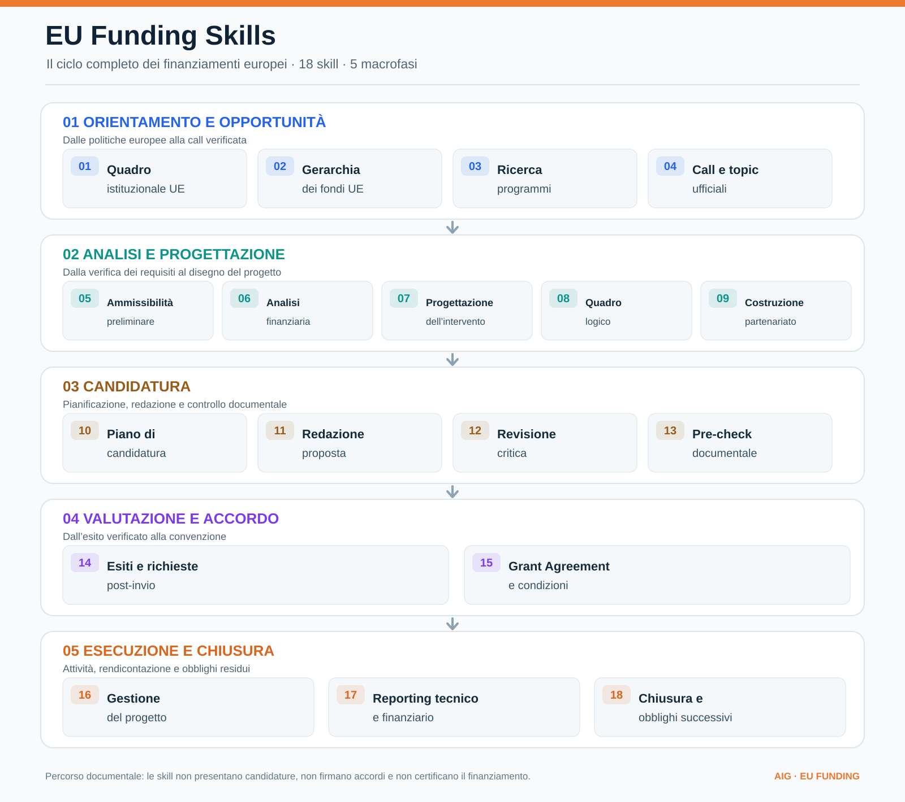

# EU Funding Skills

**Lingua / Language:** [Italiano](README.md) · English

This repository is an independent collection of skills for navigating European Union funding: from the institutional framework to proposal preparation and post-submission documentation tracking, always respecting the rules of the specific notice. Generic content, with no references to specific corporate projects.

## Available skills



[Open the vector diagram](assets/eu-funding-lifecycle.svg)

The catalog contains **43 skills: 18 core lifecycle skills and 25 specialist skills**, organized in six areas. Specialist methods are optional and should be selected according to the project, call and available evidence.

### Core lifecycle (18)

1. [`eu-institutional-framework`](eu-institutional-framework/SKILL.md) — explains and reconstructs the EU institutional framework: institutions, consultative bodies, the Commission's structure, DGs and agencies, decision-making and budget processes, with a static map and dynamic on-demand research against primary sources; it does not search calls nor assess eligibility.
2. [`eu-funding-hierarchy`](eu-funding-hierarchy/SKILL.md) — reconstructs the documented hierarchy and links between priorities, MFF (QFP), programme, work programme, call and topic, taking the funding management modes into account.
3. [`eu-funding-programme-finder`](eu-funding-programme-finder/SKILL.md) — starts from an objective and identifies plausible EU programmes, funds and instruments, distinguishing purposes, modes and official channels.
4. [`eu-funding-call-finder`](eu-funding-call-finder/SKILL.md) — searches and verifies specific topics, calls and notices, with status, phases, deadlines, conditions and primary links.
5. [`eu-funding-eligibility-checker`](eu-funding-eligibility-checker/SKILL.md) — performs a preliminary check of requirements for the applicant, eligible costs, partnership, project and submission, separating established blocks, conditions and documentation gaps. It does not issue eligibility certifications.
6. [`eu-funding-financial-checker`](eu-funding-financial-checker/SKILL.md) — distinguishes programme/call/topic/project budgets, grants, eligible costs, rates, caps, co-financing and cash flows; includes a controllable arithmetic simulation, without awarding grants.
7. [`eu-funding-project-designer`](eu-funding-project-designer/SKILL.md) — supports the substantive design of the project: context and needs, objectives, intervention logic, activities, results, impacts and verifiable indicators, with distinct states and [method sources](eu-funding-project-designer/references/design-method.md); delivers a dossier compatible with the [shared dossier](dossier/README.md) for proposal drafting, without filling the official form or inventing data.
8. [`eu-funding-logical-framework`](eu-funding-logical-framework/SKILL.md) — Logical Framework Approach: causal analysis, results chain, matrix, indicators, baselines, targets, verification sources and assumptions.
9. [`eu-funding-partnership-designer`](eu-funding-partnership-designer/SKILL.md) — defines the partnership of the specific application: call requirements from official sources (mandatory consortium vs individual application), map of needed/available competences, [documented search of entities](eu-funding-partnership-designer/references/official-sources.md) (CORDIS, partner search, NCP) with comparative assessment; **no contact and no invented agreement**, composition always labelled as a proposal.
10. [`eu-funding-application-planner`](eu-funding-application-planner/SKILL.md) — reconstructs for each specific notice/phase the required documentation, criteria and deadlines for preparing the application, without applying schemes from other programmes and without submitting applications.
11. [`eu-funding-proposal-drafter`](eu-funding-proposal-drafter/SKILL.md) — drafts the proposal according to the form actually applicable, tracing requirements, sources and evidence, with placeholders for missing data and a formal manifest validator.
12. [`eu-funding-proposal-reviewer`](eu-funding-proposal-reviewer/SKILL.md) — compares an identified version of the proposal with the criteria and conditions of the specific opportunity, separating established findings, risks, information gaps and editorial suggestions. Integrates a formal report validator; it does not certify the proposal.
13. [`eu-funding-submission-checker`](eu-funding-submission-checker/SKILL.md) — runs documentary pre-checks on the final version, annexes, channel, deadlines and conditions of the specific opportunity; separates blocks, gaps and satisfied checks without submitting applications.
14. [`eu-funding-post-submission-tracker`](eu-funding-post-submission-tracker/SKILL.md) — reconstructs, in read-only mode, events after submission, authority communications, outcomes, possible requests and deadlines; separates verified updates, gaps and proposed actions, with no recurring monitoring and no changes to portals.
15. [`eu-funding-grant-agreement-manager`](eu-funding-grant-agreement-manager/SKILL.md) — Grant Agreement analysis, contractual obligations and conditions.
16. [`eu-funding-project-manager`](eu-funding-project-manager/SKILL.md) — Documentary management of work packages, activities, deliverables and milestones.
17. [`eu-funding-reporting-manager`](eu-funding-reporting-manager/SKILL.md) — Preparation and review of technical and financial reporting.
18. [`eu-funding-closure-manager`](eu-funding-closure-manager/SKILL.md) — Documentary checks for closure, final payment and continuing obligations.

### Specialist skills (25)

#### Intelligence and orientation (3)

- [`eu-funding-project-intelligence`](eu-funding-project-intelligence/SKILL.md) — Funded-project benchmarking.
- [`eu-funding-policy-alignment`](eu-funding-policy-alignment/SKILL.md) — EU policy alignment.
- [`eu-funding-synergy-designer`](eu-funding-synergy-designer/SKILL.md) — Synergies and double funding.

#### Project design methods (5)

- [`eu-funding-needs-assessment`](eu-funding-needs-assessment/SKILL.md) — Needs and gap analysis.
- [`eu-funding-stakeholder-analysis`](eu-funding-stakeholder-analysis/SKILL.md) — Stakeholder mapping.
- [`eu-funding-theory-of-change`](eu-funding-theory-of-change/SKILL.md) — Causal pathways and assumptions.
- [`eu-funding-work-package-designer`](eu-funding-work-package-designer/SKILL.md) — Work packages and dependencies.
- [`eu-funding-risk-manager`](eu-funding-risk-manager/SKILL.md) — Risk management.

#### Economic and impact assessment (5)

- [`eu-funding-impact-assessment`](eu-funding-impact-assessment/SKILL.md) — Impact assessment.
- [`eu-funding-cost-benefit-analysis`](eu-funding-cost-benefit-analysis/SKILL.md) — Cost-benefit and sensitivity analysis.
- [`eu-funding-monitoring-evaluation`](eu-funding-monitoring-evaluation/SKILL.md) — Monitoring and evaluation.
- [`eu-funding-innovation-assessment`](eu-funding-innovation-assessment/SKILL.md) — Innovation and TRL.
- [`eu-funding-sustainability-planner`](eu-funding-sustainability-planner/SKILL.md) — Post-grant sustainability.

#### Exploitation and dissemination (4)

- [`eu-funding-dissemination-planner`](eu-funding-dissemination-planner/SKILL.md) — Communication, dissemination and exploitation.
- [`eu-funding-ipr-manager`](eu-funding-ipr-manager/SKILL.md) — Intellectual property.
- [`eu-funding-business-model-designer`](eu-funding-business-model-designer/SKILL.md) — Business and adoption models.
- [`eu-funding-replication-scaling`](eu-funding-replication-scaling/SKILL.md) — Replication and scaling.

#### Compliance and assurance (7)

- [`eu-funding-ethics-assessment`](eu-funding-ethics-assessment/SKILL.md) — Ethics pre-screening.
- [`eu-funding-dnsh-checker`](eu-funding-dnsh-checker/SKILL.md) — DNSH screening.
- [`eu-funding-gender-equality`](eu-funding-gender-equality/SKILL.md) — Gender equality and gender dimension.
- [`eu-funding-data-management`](eu-funding-data-management/SKILL.md) — DMP, FAIR and Open Science.
- [`eu-funding-state-aid-checker`](eu-funding-state-aid-checker/SKILL.md) — State aid and cumulation.
- [`eu-funding-procurement-checker`](eu-funding-procurement-checker/SKILL.md) — Procurement and subcontracting.
- [`eu-funding-audit-readiness`](eu-funding-audit-readiness/SKILL.md) — Audit readiness.

#### Proposal quality (1)

- [`eu-funding-evaluator-simulator`](eu-funding-evaluator-simulator/SKILL.md) — Evaluation simulation.

## Operating sequence

**Institutional framework → Hierarchy → Programme → Call/topic → Eligibility → Financial analysis → Project design → Logical Framework → Partnership → Application plan → Proposal draft → Review → Pre-check → Outcomes → Grant Agreement → Project management → Reporting → Closure.** Each skill can also run standalone when the programme and topic are already known.

## Language note

The skills are written in Italian, but the language of a `SKILL.md` does **not** constrain the language of the response: the agent should answer in the language the user requests, while preserving official quotations, denominations, IDs and conditions of the calls in their original form. General multilingual models usually understand instructions in both Italian and English, but recognition and interpretation may depend on model, client, terminology and request; test your own client if this matters to you. Full translation of the skills is a separate option, not an implemented feature.

## Installation

The skills follow the **Agent Skills** standard: each folder contains `SKILL.md` and, where provided, `references/` and `scripts/`, so the same package works with Claude Code, OpenCode and other compatible clients. Installing means making the `eu-funding-*` folders available in the client's skills directory.

### Install from GitHub, without cloning

Claude Code and OpenCode do not install a skill from a link: download the package and copy it into the skills directory. One command, from any terminal:

```bash
TMP="$(mktemp -d)" && curl -fsSL https://github.com/aigconsulting/eu-funding-skills/archive/refs/heads/main.tar.gz | tar -xz -C "$TMP" --strip-components=1 && mkdir -p ~/.claude/skills && cp -R "$TMP"/eu-* ~/.claude/skills/ && rm -rf "$TMP"
```

Replace `~/.claude/skills` with `.claude/skills` (project), `~/.config/opencode/skills` or `.opencode/skills`. Alternatively paste the link to your agent and ask it to install the skills from `https://github.com/aigconsulting/eu-funding-skills`: the agent downloads the archive and copies the folders.

### OpenCode: skills directly from URL

OpenCode reads an HTTP catalog, so there is nothing to copy. Add this to `opencode.json` (global or per project):

```jsonc
{
  "$schema": "https://opencode.ai/config.json",
  "skills": ["https://raw.githubusercontent.com/aigconsulting/eu-funding-skills/main"]
}
```

`index.json` lists the files and version of each skill; OpenCode caches the content and refreshes it when the version changes (`/reload` to apply).

### Inside the repository: `/install`

Open this folder in Claude Code or OpenCode and invoke `/install` (`@install` in OpenCode): the `.claude/skills/install/SKILL.md` skill asks for the target, copies or links the folders, runs the static checks and reports how to invoke the skills. To remove them, just ask the same skill: it deletes only the `eu-funding-*` folders.

### Manual install from a local copy

```bash
DEST="$HOME/.claude/skills"     # alternatively .claude/skills, ~/.config/opencode/skills, .opencode/skills, ~/.agents/skills
mkdir -p "$DEST"
for d in eu-*/; do cp -R "$d" "$DEST/${d%/}"; done
```

Instead of `cp -R`, use `ln -sfn "$PWD/${d%/}" "$DEST/${d%/}"` to keep the skills linked to the repository, so they follow its updates.

### Where to put them

| Client | Scope | Destination |
| --- | --- | --- |
| Claude Code | personal (all projects) | `~/.claude/skills/<skill>/SKILL.md` |
| Claude Code | project (commit it to share) | `.claude/skills/<skill>/SKILL.md` |
| Claude Code | plugin | `<plugin>/skills/<skill>/SKILL.md` |
| OpenCode | global | `~/.config/opencode/skills/<skill>/SKILL.md` (or `$XDG_CONFIG_HOME/opencode/skills`) |
| OpenCode | project | `.opencode/skills/<skill>/SKILL.md` |
| Other Agent Skills clients | global | `~/.agents/skills/<skill>/SKILL.md` |

### Usage

- **Claude Code:** `/skills` lists the skills, `/eu-funding-hierarchy` invokes one. If the skills directory did not exist when the session started, run `/reload-skills`.
- **OpenCode:** `@eu-funding-hierarchy` loads it, or it activates automatically when relevant; `/reload` reloads the configuration. OpenCode also looks for skills in `~/.claude/skills` and `~/.agents/skills` (and in the matching project directories), so the Claude Code install is already sufficient. Additional directories can be listed under the `skills` key of `opencode.json(c)`.
- **Other clients:** load the `eu-funding-*` folders from their skills directory; `~/.agents/skills` is the shared convention. For clients that read only a project instructions file (`AGENTS.md`, `CLAUDE.md`, editor rules), it is best to point to the relevant `SKILL.md`, which remains the single source.

## Static checks

From the package root:

```bash
set -e
for script in eu-*/scripts/check_skill.py; do python3 "$script"; done
for script in eu-funding-*/scripts/test_*.py; do [ ! -f "$script" ] || python3 "$script"; done
python3 dossier/test_dossier.py
python3 scripts/check_index.py
```

The `check_skill.py` checks attest **only structure, metadata and local consistency**, not agentic capability or legal compliance. Skill 05 adds 10 unit tests for the calculator; Skill 07 adds 16 unit tests for the formal validator, Skill 08 adds 25 for the review report, Skill 09 adds 49 for the pre-check and Skill 10 adds 56 for the post-submission tracking. None of these is a legal-compliance check. Sources must be verified at the time of use; the cases in the `references/test-cases.md` files are not executed agentic tests. No skill submits funding applications, replies to authority requests, performs registrations or runs recurring monitors. The Skill 09 pre-check is not an eligibility certification and is not a submission receipt.

## CI

The `.github/workflows/ci.yml` workflow runs, on every pull request and push to `main`, the same commands documented above: the static `check_skill.py` checks, the `test_*.py` unit tests and the consistency of the `index.json` catalog via `scripts/check_index.py` (listed files exist, no uncatalogued files present, version format; see the script header for the version recipe). No credentials, no access to funding portals, no model calls: under two minutes on an `ubuntu-latest` runner per run (~5–10 minutes/month across a few dozen PRs), with no recurring schedules.

### What the CI does NOT prove

The CI attests **only structure, metadata, local consistency and the arithmetic validity of the deterministic validators**. It does **not** prove: the exactness of call rules, accessibility of sources at the time of use, substantive correctness of proposals, legal compliance of outputs or the actual behaviour of agents. End-to-end tests with an agent are tracked in dedicated issues (see the repository's end-to-end validation issue).

## Versions

- Catalog: 43 skills; the 26 additions are operational drafts, not validated agent runs.
- Last documented historical package release: **v0.11**, 10 November 2026. Current per-skill versions are in `index.json`.
- v0.11 adds the `.claude/skills/install` skill (`/install`, `@install`), the HTTP catalog `index.json` to install the skills in OpenCode from a URL, and installation instructions for Claude Code, OpenCode and other Agent Skills clients. If you modify a skill's files, regenerate `index.json` with the new version.
