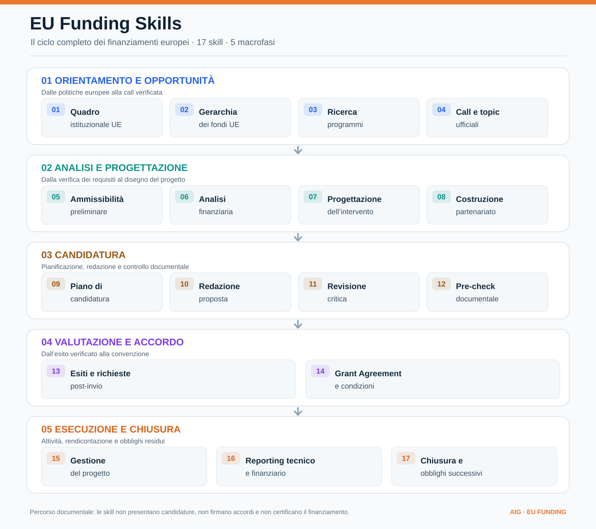

# EU Funding Skills

**Lingua / Language:** [Italiano](README.md) · [English](README.en.md)

Raccolta autonoma di skill per orientarsi nei finanziamenti dell'Unione europea, dalla struttura istituzionale alla ricerca dei finanziamenti, dalla progettazione e candidatura fino alla gestione documentale del Grant Agreement, dell'attuazione, della rendicontazione e della chiusura, nel rispetto della disciplina dello specifico avviso. Contenuti generali, senza riferimenti a specifici progetti aziendali.


> **Nota lingua:** le skill sono scritte in italiano, ma la lingua di una `SKILL.md` **non vincola** quella della risposta per risultati affidabili l'agente deve rispettare la lingua richiesta dall'utente, mantenendo in forma originale citazioni, denominazioni ufficiali, identificativi e condizioni dei bandi. I modelli multilingue in genere comprendono istruzioni in italiano e in inglese, ma riconoscimento e interpretazione possono dipendere da modello, client, terminologia e richiesta: la traduzione integrale delle skill resta un'opzione valutata separatamente, non una funzione implementata.

## Skill disponibili



[Apri il diagramma vettoriale SVG](assets/eu-funding-lifecycle.svg)

| Macrofase | Passaggi | Risultato documentale |
| --- | --- | --- |
| **1. Orientamento e opportunità** | Quadro UE → gerarchia fondi → programmi → call/topic | Individuazione della misura e delle fonti ufficiali |
| **2. Analisi e progettazione** | Ammissibilità → finanza → progetto → partenariato | Requisiti, budget e disegno progettuale motivati |
| **3. Candidatura** | Pianificazione → redazione → review → pre-check | Proposta e controlli documentali pre-invio |
| **4. Valutazione e accordo** | Tracciamento esiti → Grant Agreement | Esiti verificati e obblighi contrattuali documentati |
| **5. Esecuzione e chiusura** | Project management → reporting → closure | Evidenze di avanzamento, rendicontazione e obblighi residui |

Le fasi rappresentano un **percorso analitico e documentale**, non un flusso eseguito automaticamente. Il passaggio alla convenzione e alla gestione post-concessione presuppone gli atti effettivamente intervenuti; selezione, firma, erogazione e saldo sono eventi distinti. Ogni skill resta utilizzabile autonomamente quando dispone delle fonti e degli input necessari.

**Elenco completo delle 17 skill, nello stesso ordine e con la stessa numerazione del diagramma.** La numerazione indica il percorso operativo, non modifica i nomi delle skill o i riferimenti dei file.

1. [`eu-institutional-framework`](eu-institutional-framework/SKILL.md) — Quadro istituzionale UE: istituzioni, DG, agenzie e processi decisionali.
2. [`eu-funding-hierarchy`](eu-funding-hierarchy/SKILL.md) — Gerarchia dei fondi: priorità, QFP, programmi, work programme, call e topic.
3. [`eu-funding-programme-finder`](eu-funding-programme-finder/SKILL.md) — Ricerca dei programmi europei pertinenti agli obiettivi del progetto.
4. [`eu-funding-call-finder`](eu-funding-call-finder/SKILL.md) — Ricerca e verifica di call e topic, documenti ufficiali, scadenze e rettifiche.
5. [`eu-funding-eligibility-checker`](eu-funding-eligibility-checker/SKILL.md) — Verifica preliminare dei requisiti del beneficiario, del partenariato e del progetto.
6. [`eu-funding-financial-checker`](eu-funding-financial-checker/SKILL.md) — Analisi di budget, costi ammissibili, tassi di finanziamento e cofinanziamento.
7. [`eu-funding-project-designer`](eu-funding-project-designer/SKILL.md) — Progettazione dell'intervento: contesto, obiettivi, attività, risultati e indicatori.
8. [`eu-funding-partnership-designer`](eu-funding-partnership-designer/SKILL.md) — Costruzione del partenariato e verifica dei ruoli richiesti dalla call.
9. [`eu-funding-application-planner`](eu-funding-application-planner/SKILL.md) — Pianificazione della candidatura e documentazione necessaria.
10. [`eu-funding-proposal-drafter`](eu-funding-proposal-drafter/SKILL.md) — Redazione della proposta secondo il formulario effettivamente applicabile.
11. [`eu-funding-proposal-reviewer`](eu-funding-proposal-reviewer/SKILL.md) — Revisione critica della proposta rispetto ai requisiti e ai criteri di valutazione.
12. [`eu-funding-submission-checker`](eu-funding-submission-checker/SKILL.md) — Controllo documentale pre-invio di file, allegati, formati e scadenze.
13. [`eu-funding-post-submission-tracker`](eu-funding-post-submission-tracker/SKILL.md) — Tracciamento degli esiti, delle comunicazioni e delle richieste post-invio.
14. [`eu-funding-grant-agreement-manager`](eu-funding-grant-agreement-manager/SKILL.md) — Analisi del Grant Agreement, delle condizioni e degli obblighi contrattuali.
15. [`eu-funding-project-manager`](eu-funding-project-manager/SKILL.md) — Gestione documentale di work package, attività, deliverable e milestone.
16. [`eu-funding-reporting-manager`](eu-funding-reporting-manager/SKILL.md) — Preparazione e controllo del reporting tecnico-finanziario.
17. [`eu-funding-closure-manager`](eu-funding-closure-manager/SKILL.md) — Verifica documentale della chiusura, del saldo e degli obblighi successivi.

## Ordine operativo

**Quadro istituzionale → Gerarchia → Programma → Call/topic → Ammissibilità → Analisi finanziaria → Progettazione e partenariato → Piano di candidatura → Redazione → Revisione → Pre-check → Esiti → Grant Agreement → Gestione progetto → Reporting → Chiusura.** È possibile eseguire le singole skill autonomamente quando si conoscono già programma e topic.

## Installazione

Le skill seguono lo standard **Agent Skills**: ogni cartella contiene `SKILL.md`, `references/` e `scripts/`, quindi lo stesso pacchetto funziona con Claude Code, OpenCode e gli altri client compatibili. Installare significa rendere disponibili le cartelle `eu-funding-*` nella directory di skill del client.

### Installazione da GitHub, senza clonare

Claude Code e OpenCode non installano una skill da un link: si scarica il pacchetto e lo si copia nella directory di skill. Un solo comando, da qualsiasi terminale:

```bash
TMP="$(mktemp -d)" && curl -fsSL https://github.com/aigconsulting/eu-funding-skills/archive/refs/heads/main.tar.gz | tar -xz -C "$TMP" --strip-components=1 && mkdir -p ~/.claude/skills && cp -R "$TMP"/eu-* ~/.claude/skills/ && rm -rf "$TMP"
```

Sostituisci `~/.claude/skills` con `.claude/skills` (progetto), `~/.config/opencode/skills` o `.opencode/skills`. In alternativa incolla il link all'agente e chiedi di installare le skill da `https://github.com/aigconsulting/eu-funding-skills`: scarica l'archivio e copia le cartelle.

### OpenCode: skill direttamente da URL

OpenCode legge un catalogo HTTP, quindi non serve copiare nulla. Aggiungi in `opencode.json` (globale o di progetto):

```jsonc
{
  "$schema": "https://opencode.ai/config.json",
  "skills": ["https://raw.githubusercontent.com/aigconsulting/eu-funding-skills/main"]
}
```

`index.json` elenca file e versione di ogni skill; OpenCode scarica il contenuto in cache e lo rinnova quando la versione cambia (`/reload` per applicare).

### Nel repository: `/install`

Apri questa cartella in Claude Code o OpenCode e invoca `/install` (`@install` in OpenCode): la skill `.claude/skills/install/SKILL.md` chiede la destinazione, copia o collega le cartelle, esegue i controlli statici e riporta come invocare le skill. Per rimuoverle basta chiederlo alla stessa skill: elimina solo le cartelle `eu-funding-*`.

### Installazione manuale da una copia locale

```bash
DEST="$HOME/.claude/skills"     # oppure .claude/skills, ~/.config/opencode/skills, .opencode/skills, ~/.agents/skills
mkdir -p "$DEST"
for d in eu-*/; do cp -R "$d" "$DEST/${d%/}"; done
```

Sostituendo `cp -R` con `ln -sfn "$PWD/${d%/}" "$DEST/${d%/}"` le skill restano collegate al repository e ne seguono gli aggiornamenti.

### Dove metterle

| Client | Ambito | Destinazione |
| --- | --- | --- |
| Claude Code | personale (tutti i progetti) | `~/.claude/skills/<skill>/SKILL.md` |
| Claude Code | progetto (da committare per condividerlo) | `.claude/skills/<skill>/SKILL.md` |
| Claude Code | plugin | `<plugin>/skills/<skill>/SKILL.md` |
| OpenCode | globale | `~/.config/opencode/skills/<skill>/SKILL.md` (o `$XDG_CONFIG_HOME/opencode/skills`) |
| OpenCode | progetto | `.opencode/skills/<skill>/SKILL.md` |
| Altri client Agent Skills | globale | `~/.agents/skills/<skill>/SKILL.md` |

### Uso

- **Claude Code:** `/skills` elenca le skill, `/eu-funding-hierarchy` la invoca. Se la directory di skill non esisteva all'avvio della sessione, eseguire `/reload-skills`.
- **OpenCode:** `@eu-funding-hierarchy` la carica, oppure si attiva da sola quando pertinente; `/reload` ricarica la configurazione. OpenCode cerca le skill anche in `~/.claude/skills` e `~/.agents/skills` (e nelle rispettive directory di progetto), quindi l'installazione per Claude Code è già sufficiente. Directory aggiuntive si possono elencare nella chiave `skills` di `opencode.json(c)`.
- **Altri client:** caricano le cartelle `eu-funding-*` dalla propria directory di skill; `~/.agents/skills` è la convenzione condivisa. Per i client che leggono soltanto un file di istruzioni di progetto (`AGENTS.md`, `CLAUDE.md`, regole dell'editor) conviene rimandare al `SKILL.md` della skill pertinente, che resta la fonte unica.

## Controlli statici

Dalla radice del pacchetto:

```bash
python3 eu-funding-hierarchy/scripts/check_skill.py
python3 eu-funding-programme-finder/scripts/check_skill.py
python3 eu-funding-call-finder/scripts/check_skill.py
python3 eu-funding-eligibility-checker/scripts/check_skill.py
python3 eu-funding-financial-checker/scripts/check_skill.py
python3 eu-funding-financial-checker/scripts/test_calculations.py
python3 eu-funding-application-planner/scripts/check_skill.py
python3 eu-funding-proposal-drafter/scripts/check_skill.py
python3 eu-funding-proposal-drafter/scripts/test_validator.py
python3 eu-funding-proposal-reviewer/scripts/check_skill.py
python3 eu-funding-proposal-reviewer/scripts/test_validator.py
python3 eu-funding-submission-checker/scripts/check_skill.py
python3 eu-funding-submission-checker/scripts/test_validator.py
python3 eu-funding-post-submission-tracker/scripts/check_skill.py
python3 eu-funding-post-submission-tracker/scripts/test_validator.py
```

I controlli `check_skill.py` attestano **solo struttura, metadati e coerenza locale**, non capacità agentiche o conformità giuridica. La Skill 05 aggiunge 10 test unitari aritmetici del calcolatore; la Skill 07 aggiunge 16 test unitari del validatore formale, la Skill 08 ne aggiunge 25 per il rapporto di revisione e la Skill 09 ne aggiunge 49 per il pre-check e la Skill 10 ne aggiunge 56 per il tracciamento post-invio. Nessuno è una verifica di conformità normativa. Le fonti devono essere verificate all'atto dell'uso; i casi nei file `references/test-cases.md` non sono test agentici eseguiti. Nessuna skill presenta domande di finanziamento, risponde a richieste delle autorità, effettua registrazioni o controlli ricorrenti autonomi. Il pre-check della Skill 09 non certifica ammissibilità e non è una ricevuta di invio.

## CI

Il workflow `.github/workflows/ci.yml` esegue, a ogni pull request e push su `main`, gli stessi comandi documentati sopra: controlli statici `check_skill.py`, test unitari `test_*.py` e congruenza del catalogo `index.json` tramite `scripts/check_index.py` (esistenza dei file elencati, assenza di file non catalogati, formato della versione; vedi l'intestazione dello script per la ricetta delle versioni). Nessuna credenziale, nessun accesso a portali di finanziamento, nessuna chiamata a modelli: meno di due minuti su un runner `ubuntu-latest` a esecuzione (~5–10 minuti/mese su docina di PR), senza schedulazioni ricorrenti.

### Cosa NON prova la CI

La CI attesta **solo struttura, metadati, coerenza locale e validità aritmetica dei validatori deterministici**. **Non** prova: l'esattezza delle regole dei bandi, l'accessibilità delle fonti al momento dell'uso, la correttezza sostanziale delle proposte, la conformità giuridica delle uscite o il comportamento reale degli agenti. Le prove end-to-end con agente sono tracciate in issue specifiche (vedi la issue di validazione end-to-end del repository).

## Dossier progettuale condiviso

La cartella [`dossier/`](dossier/) contiene una proposta di **formato di scambio** fra le skill: schema minimo versionato ( [`dossier.schema.json`](dossier/dossier.schema.json) ), esempio [sintetico](dossier/example-dossier.json), validatore deterministico ( `python3 dossier/check_dossier.py <file.json>` ) e [test unitari](dossier/test_dossier.py). Il dossier è **opzionale**, funziona su file locali senza persistenza remota e consegna l'evidenza dei passaggi fra le skill (`opportunita`, `evidenze`, `requisiti`, `progetto`, `finanza`, `revisioni`) con gli stati `VERIFICATO`, `DA_CONFERMARE`, `IPOTESI`, `PROPOSTA`, `DECISIONE_APPROVATA`, `MANCANTE`, `NON_APPLICABILE`; una rettifica del bando **non conferma** automaticamente osservazioni precedenti (sistema del `ultima_verifica` — [README dossier](dossier/README.md)). Non è un servizio né un archivio di dati personali.

## Versioni

- Skill 00–12: ciascuna v0.1 (bozza operativa testabile).
- Pacchetto cumulativo: **v0.11**, 10 novembre 2026.
- v0.11 aggiunge la skill `.claude/skills/install` (`/install`, `@install`), il catalogo HTTP `index.json` per installare le skill in OpenCode da URL e le istruzioni di installazione per Claude Code, OpenCode e gli altri client Agent Skills. Se modifichi i file di una skill, rigenera `index.json` con la nuova versione.

## Ciclo post-concessione

Le fasi 14–17 dell'elenco principale si applicano dopo gli eventi documentati di selezione, sottoscrizione ed efficacia della convenzione. Le skill relative a Grant Agreement, gestione del progetto, reporting e chiusura sono guide documentali e non sostituiscono i controlli dell'autorità finanziatrice. Non presumono che la selezione equivalga a una convenzione firmata o a un pagamento ricevuto.

### Interoperabilità con Business Funding Skills

Il dossier canonico per questo repository resta `eu-funding-skills/dossier@v1`. Il repository [Business Funding Skills](https://github.com/aigconsulting/business-funding-skills) mette a disposizione un formato distinto e un convertitore **unidirezionale, limitato ai GRANT UE**. La conversione non eleva stati e trasferisce dati di progetto o finanza **solo quando esplicitamente mappabili**; campi non supportati bloccano l'export. Il risultato va controllato tramite `dossier/check_dossier.py`. Non è presente una sincronizzazione automatica tra repository né un meccanismo di aggiornamento del dossier.
